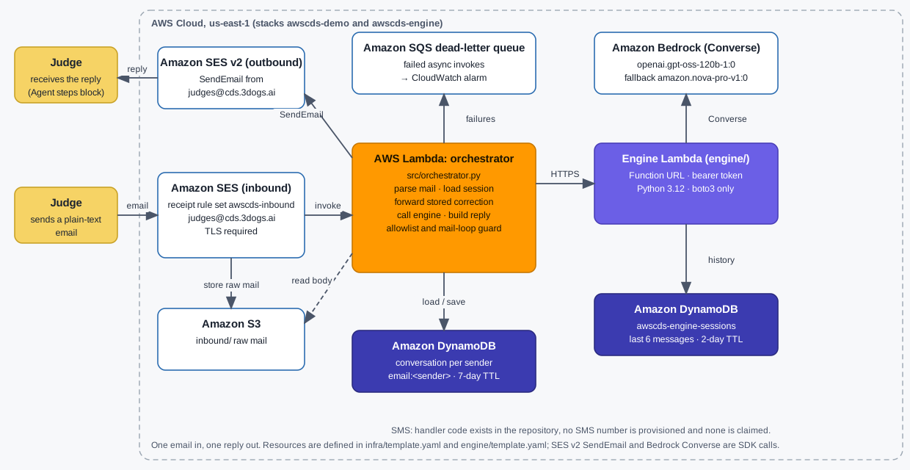

# AWS CDS Agentic AI Partner Hackathon -- "Rex" by 3Dogs Nexus (email edition)

Rex is an agentic AI concierge for Amazon SES. A judge emails `judges@cds.3dogs.ai`; an SES receipt rule stores the message in S3 and invokes the orchestrator Lambda; the orchestrator loads the conversation from DynamoDB, calls the engine Lambda (`engine/`, Amazon Bedrock Converse) for an answer, saves the conversation and replies from the same mailbox. Every answered question ends with the **agent steps** it took, so the agentic loop is visible in the judge's inbox.

**Status:** deployed 18 Oct 2026 (stack `awscds-demo`, us-east-1). To check it yourself: email `judges@cds.3dogs.ai` from any ordinary mailbox; the reply ends with an "Agent steps" block.

## Judge access

1. Send any plain-text question from any normal mailbox to **judges@cds.3dogs.ai**. Your mail server must support STARTTLS (every major provider does); the receipt rule rejects unencrypted delivery.
2. Expect a reply within about a minute, from the same address, signed "Rex, 3Dogs Nexus", ending with an **Agent steps** list of what happened to your message.
3. Reply in the same thread to continue; follow-ups keep context (for example "explain that", or "that's wrong"). The conversation is keyed on your sender address, and a stored correction such as "that's wrong" is forwarded with your next question.
4. If you have had no reply after 10 minutes, message the team through the Devpost project page and we will check the dead-letter queue and alarm.

Architecture diagram: [`docs/architecture.svg`](docs/architecture.svg) (PNG copy: [`docs/architecture.png`](docs/architecture.png)). Demo video: [DEMO VIDEO URL - owner to add].



## Qualifying AWS service and SDK calls

* **Amazon SES (the qualifying AWS CDS service).** Inbound: SES receipt rule set `awscds-inbound` (`infra/template.yaml`, `AWS::SES::ReceiptRuleSet` and `AWS::SES::ReceiptRule`). Outbound: `src/channels.py` builds `boto3.client("sesv2")` in `_get_ses_client()` (line 209) and calls `client.send_email(...)` inside `send_email()` (line 1074).
* **Amazon Bedrock.** `engine/app.py` calls the Converse API. Primary model `openai.gpt-oss-120b-1:0`, fallback `amazon.nova-pro-v1:0` (both overridable with `MODEL_ID` and `MODEL_ID_FALLBACK`); every answer lists which model answered in its Agent steps block.
* Not used: Amazon Bedrock AgentCore (recommended by the rules, not required), AWS End User Messaging (SMS), WhatsApp.

## What happens to one email

1. `received` -- SES receipt rule (TLS required) -> S3 (`inbound/`) -> orchestrator Lambda (async).
2. `session` -- conversation `email:<sender>` loaded from DynamoDB (new or returning, turn count).
3. `feedback` -- a stored correction from an earlier turn is forwarded with the question.
4. `engine` -- the orchestrator calls the engine Lambda at `NEXUS_ENDPOINT` (the Function URL of the `awscds-engine` Lambda) over HTTPS with a bearer token; the engine runs Amazon Bedrock Converse with the conversation history stored in DynamoDB, tracking clarifying questions across turns.
5. `saved` -- the conversation record is updated (turn count, last question/answer, steps, rolling TTL).
6. `reply` -- sent with SES v2 to the sender, signed "Rex, 3Dogs Nexus", with the steps block appended.

Failures never raise to SES: the Lambda always returns 200, logs the failure, answers with a short apology when it can, and failed async invocations land on a dead-letter queue and trip a CloudWatch alarm.

## Safety properties (each is covered by a test)

* Inbound recipients: the receipt rule matches exactly `judges@cds.3dogs.ai`.
* IAM has no wildcard action and no bare `*` resource (X-Ray tracing is off for that reason).
* Mail-loop guard: auto-submitted mail, robot senders (`mailer-daemon`, `no-reply`, ...) and our own signed reply coming back are never answered.
* Outbound replies go to the inbound sender only; `ALLOWED_DESTINATIONS` gates every other send.
* The engine Lambda's IAM role in `engine/template.yaml` scopes Bedrock access to the two foundation-model ARNs used by the engine code, and DynamoDB actions to `GetItem` and `PutItem` on the sessions table ARN (the template in this repo is scoped; the running `awscds-engine` stack is updated at redeploy).

## Limitations

* Cold starts on the first request can add latency.
* Sessions expire after 7 days for the email stack; engine memory keeps the last 6 messages for 2 days.
* Replies are capped at 16000 characters; longer replies are truncated with a note.
* The engine answers general business questions; no customer-data source is connected.
* Mail must support STARTTLS.
* SMS code exists in `src/channels.py` but is not provisioned.
* Known limits (disclosed, not fixed in this submission):
  * No per-sender rate limit on the public mailbox.
  * Engine model timeout (25 s), orchestrator timeout (30 s) and Lambda timeout (40 s) are not aligned, so the fallback model cannot rescue a slow primary.
  * The email template still contains SNS/SMS resources although SMS is not provisioned.
  * The engine has no input-length cap and no health endpoint.
  * The repository's `engine/template.yaml` IAM role is scoped to the two Bedrock foundation-model ARNs and to `GetItem`/`PutItem`, but the currently running `awscds-engine` stack still has the broader policy until it is redeployed (the repo template and the running stack do NOT match).
  * Reply truncation is at 16000 characters.

## Layout

| Path | Purpose |
|---|---|
| `src/orchestrator.py` | Lambda handler: session, engine call, steps block, loop guard |
| `src/channels.py` | SES inbound parsing (S3 body fetch), SES v2 outbound, allowlist |
| `src/sessions.py` | DynamoDB conversation record (one item per `channel:sender`) |
| `src/nexus_client.py` | HTTPS client for the engine Lambda |
| `engine/app.py` | Engine Lambda (Python 3.12, boto3 only): Amazon Bedrock Converse, session history in DynamoDB, bearer-token auth |
| `engine/template.yaml` | SAM stack `awscds-engine`: Lambda, DynamoDB sessions table, scoped IAM role |
| `engine/README.md` | Engine build, deploy and API notes |
| `infra/template.yaml` | SAM/CloudFormation stack (SES rule set `awscds-inbound`, S3, Lambda, DynamoDB, DLQ, alarm) |
| `tools/awscds_deploy/awscds_deploy.py` | Deploy helper (in-repo): `--dry-run`, deploy, SES identity + activation, smoke test, inventory, destroy script; its own tests live in `tools/awscds_deploy/tests/` |
| `tests/` | Offline tests (no network, no AWS) |
| `tests/test_engine_app.py` | Engine Lambda tests (Bedrock and DynamoDB mocked, no network) |
| `docs/` | Architecture, demo guide, video script, ACE opportunity text |

SMS handling code exists in `src/channels.py` but this submission is **email only**: no SMS number is provisioned or claimed.

## Environment (set by the templates)

| Variable | Value / purpose |
|---|---|
| `SES_FROM` | `judges@cds.3dogs.ai`, the sending identity |
| `ALLOWED_DESTINATIONS` | comma-separated mailboxes; must be non-empty (replies to the inbound sender are always allowed) |
| `SESSIONS_TABLE` | DynamoDB table (hash key `session_id`) |
| `SES_INBOUND_BUCKET`, `SES_INBOUND_PREFIX` | where SES stores raw mail |
| `NEXUS_ENDPOINT`, `NEXUS_TOKEN` | engine Lambda Function URL and bearer token (stack parameters; `NoEcho`) |
| `AGENT_STEPS` | `1` appends the steps block to email replies |

## Tests

```
python3.12 -m pip install pytest boto3 pyyaml
python3.12 -m pytest tests                       # Lambda code + template contract + email round trip (offline)
python3.12 -m pytest tests/test_engine_app.py    # engine Lambda (Bedrock & DynamoDB mocked, offline)
python3.12 -m pytest tools/awscds_deploy/tests   # deploy helper (every stubbed AWS call checked against the botocore model)
```

## Deploy (owner-run, from the owner's AWS account)

The deploy helper lives in the repository at `tools/awscds_deploy/awscds_deploy.py`.

Deploy the engine stack first, then pass its Function URL and token to the email stack:

```
# 1. Deploy the engine stack
cd engine && aws cloudformation package --template-file template.yaml --s3-bucket <bucket> --output-template-file out.yaml && aws cloudformation deploy --template-file out.yaml --stack-name awscds-engine --capabilities CAPABILITY_NAMED_IAM CAPABILITY_AUTO_EXPAND --parameter-overrides EngineToken=<token>

# 2. Read back the engine Function URL
aws cloudformation describe-stacks --stack-name awscds-engine \
  --query "Stacks[0].Outputs[?OutputKey=='EngineUrl'].OutputValue" --output text

# 3. Deploy the email stack with the engine URL as NexusEndpoint
python3.12 tools/awscds_deploy/awscds_deploy.py --dry-run --template infra/template.yaml --src src
python3.12 tools/awscds_deploy/awscds_deploy.py --deploy --yes --bucket <deploy-bucket> \
  --param NexusEndpoint=<engine-function-url> --param NexusToken=<token>
python3.12 tools/awscds_deploy/awscds_deploy.py --activate-identity --yes      # prints the DKIM CNAMEs and MX record to add to DNS
python3.12 tools/awscds_deploy/awscds_deploy.py --smoke --yes --smoke-from <verified-sender>
python3.12 tools/awscds_deploy/awscds_deploy.py --destroy-script destroy_awscds.sh --yes   # tag-scoped teardown (project=awscds)
```

`--dry-run` parses the real template, enforces the recipient allowlist and the no-wildcard IAM rule, and prints every AWS call the deploy would make without making any. SES receipt rule sets are inactive until `--activate-identity` runs, and it refuses to replace a different active rule set.

### Smoke testing

The `--smoke` mail is sent through the SES API, whose envelope sender is an `amazonses.com` bounce address. The Lambda's mail-loop guard treats that as robot mail and ignores it **by design**, so `--smoke` only proves that SES can deliver into the receipt rule; it does not produce a reply. To verify the full loop, send a message from a real mailbox (see "Judge access") and check for the "Agent steps" block in the reply. That is how the 18 Oct 2026 verification was done.

## Hackathon requirements outside this repository

The stacks are deployed to the owner's AWS account with the in-repo helper (`tools/awscds_deploy/awscds_deploy.py`); the ACE opportunity (text in `docs/ACE_OPPORTUNITY.md`) and the Devpost submission are manual owner actions. Nothing in this repository runs on its own: deploys, submissions and sends only happen when the owner invokes them explicitly.
